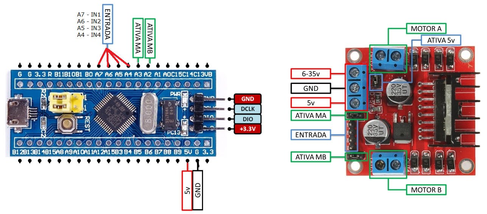
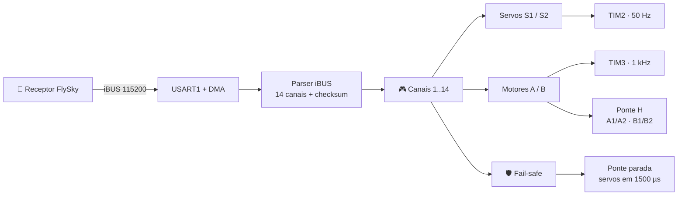

<div align="center">

# ⚡ ESC_Brushed

### Firmware de ESC escovado dual para STM32F103C8T6

**iBUS · FlySky · PWM · Ponte H · Servo · DMA · STM32 HAL**


> **EN:** A compact, DMA-driven brushed ESC firmware for the STM32F103C8T6 (Blue Pill):
> FlySky iBUS input, dual H-bridge motor control, two servo outputs and a built-in
> fail-safe — all in bare-metal C with STM32 HAL.

**Construído sobre a biblioteca [J3 iBus FlySky](https://github.com/NelsonLima07/iBus_FlySky).**

</div>

<p align="center">
  
</p>

---

## 🚀 O que é este projeto?

Um firmware enxuto e direto ao ponto que transforma um **STM32F103C8T6 (Blue Pill)** em um
**controlador de ESC escovado duplo**. O receptor FlySky fala **iBUS** pela UART, o STM32
interpreta até **14 canais com checksum**, gera **dois PWM de servo** e comanda **duas pontes H**
para os motores — com **DMA**, **HAL** e **fail-safe** de série.

Sem bibliotecas pesadas, sem RTOS, sem bit-banging: só o essencial, em C, rodando a **72 MHz**.

---

## ✨ Destaques

- ⚡ **Recepção 100% por DMA** — a CPU não fica presa esperando bytes da UART.
- 🧠 **Parser iBUS próprio** — 14 canais, little-endian, com validação de checksum.
- 🎛️ **PWM em hardware** — TIM2 (servos, 50 Hz) e TIM3 (motores, 1 kHz) sem software timing.
- 🚗 **Duas pontes H** — controle de sentido e velocidade para motores A e B.
- 🛡️ **Fail-safe inteligente** — sem sinal por 5 s, pontes param e servos centralizam.
- 🧩 **Estrutura modular** — aplicação isolada em `Core/Src/usr`, pronta para o CubeMX.
- 🪶 **Leve** — ~14 KB de flash e ~1,8 KB de RAM no build Debug.
- 🔌 **Pronto para o Blue Pill** — pinagem documentada e configuração `.ioc` incluída.

---

## 🧠 Arquitetura



O fluxo é simples de propósito: **recebe → valida → mapeia → atua**. Cada quadro iBUS válido
atualiza os canais; o loop principal só aplica os valores nos periféricos.

---

## 🔌 Hardware e pinagem

| Função | Pino | Periférico / Configuração |
|---|---|---|
| iBUS RX | **PB7** | `USART1_RX` remapeado · 115200 8N1 |
| iBUS TX | **PB6** | `USART1_TX` remapeado (não utilizado) |
| Servo S1 | **PA2** | `TIM2_CH3` · 50 Hz · 1000–2000 µs |
| Servo S2 | **PA3** | `TIM2_CH4` · 50 Hz · 1000–2000 µs |
| Motor A (PWM) | **PA6** | `TIM3_CH1` · 1 kHz |
| Motor B (PWM) | **PA7** | `TIM3_CH2` · 1 kHz |
| Ponte A (sentido) | **PC14 / PC15** | `A1 / A2` · GPIO push-pull |
| Ponte B (sentido) | **PA4 / PA5** | `B1 / B2` · GPIO push-pull |
| LED de status | **PC13** | GPIO · pisca a cada 1 s |
| Debug | **PA13 / PA14** | SWD |

> Consulte `Docs/stm32f103c8t6_pinout_voltage01.png` e `Docs/Ponte_H_L298_HW95.jpg` para o
> esquema completo da montagem.

---

## ⏱️ Temporização

| Periférico | Clock | Prescaler | Período | Resultado |
|---|---|---|---|---|
| SYSCLK | 8 MHz × 9 | — | — | **72 MHz** |
| TIM2 (servos) | 72 MHz | 71 | 19999 | **50 Hz** · pulso 1–2 ms |
| TIM3 (motores) | 72 MHz | 71 | 999 | **1 kHz** · duty 0–100% |

---

## 📡 Protocolo iBUS (FlySky)

Cada quadro tem **32 bytes**:

```text
┌──────┬──────┬─────────────────────────────┬──────────────┐
│ 0x20 │ 0x40 │  CH1..CH14  (28 bytes, LE)  │  Checksum    │
└──────┴──────┴─────────────────────────────┴──────────────┘
   len    cmd          1000..2000 µs           0xFFFF - soma
```

O checksum é calculado como `0xFFFF - soma(todos os bytes do pacote)`. Se não bater, o quadro
é descartado e os canais anteriores são preservados — nada de valores corrompidos indo para os
motores.

---

## 🔗 Projetos relacionados

### 📡 J3 iBus FlySky — a biblioteca por trás do receptor

Este firmware nasceu junto com a biblioteca **[J3 iBus FlySky](https://github.com/NelsonLima07/iBus_FlySky)**,
uma implementação em C do protocolo iBUS para STM32 com HAL, DMA e validação de checksum.

| | Este projeto | J3 iBus FlySky |
|---|---|---|
| **Foco** | Aplicação completa de ESC escovado | Biblioteca reutilizável de iBUS |
| **Conteúdo** | Servos, pontes H, fail-safe, LED | Parser, receptor, API e exemplo |
| **Build** | STM32CubeIDE | CMake + Ninja (+ `.ioc`) |
| **Licença** | GPL-3.0 | GPL-3.0 |

> A versão embarcada aqui (`Core/Src/usr/J3_IBUS_FLYSKY.c`) é uma versão compacta da biblioteca.
> Para novos projetos, prefira a versão evoluída, com buffers estáticos, camadas separadas e API
> documentada.

<p align="left">
  <a href="https://github.com/NelsonLima07/iBus_FlySky">
    
  </a>
</p>

---

## 🧩 Estrutura do projeto

```text
ESC_Brushed/
├── CubeIDE/
│   └── J3_ESC_Brushed/
│       ├── Core/
│       │   ├── Inc/usr/          # headers da aplicação
│       │   └── Src/usr/          # main_ESC_Brushed.c · J3_IBUS_FLYSKY.c
│       ├── Drivers/              # STM32F1 HAL + CMSIS
│       ├── J3_ESC_Brushed.ioc    # configuração CubeMX
│       └── STM32F103C8TX_FLASH.ld
├── Docs/
│   ├── Descricao.txt
│   ├── Esquema.png
│   ├── Ponte_H_L298_HW95.jpg
│   ├── stm32f103c8t6_pinout_voltage01.png
│   └── dm00042534-stm32-cross-series-timer-overview.pdf
├── LICENSE
└── README.md
```

---

## 🛠️ Como compilar e gravar

```bash
git clone https://github.com/NelsonLima07/ESC_Brushed.git
```

1. Abra o **STM32CubeIDE**.
2. `File → Import → Existing Projects into Workspace`.
3. Selecione `CubeIDE/J3_ESC_Brushed`.
4. Compile em **Debug** (desenvolvimento) ou **Release** (`-Os`, menor binário).
5. Grave com **ST-Link** usando a configuração `J3_ESC_Brushed Debug.launch`.

O binário final fica em `CubeIDE/J3_ESC_Brushed/Debug/J3_ESC_Brushed.elf` (ou `Release/`).

---

## ⚙️ Configuração rápida

| Macro | Padrão | O que faz |
|---|---|---|
| `CH_SERVO_A` | `1` | Canal do rádio para o servo S1 |
| `CH_SERVO_B` | `2` | Canal do rádio para o servo S2 |
| `CH_MOTOR_A` | `3` | Canal do rádio para o motor A |
| `CH_MOTOR_B` | `3` | Canal do rádio para o motor B |
| `RX_VAL_MIN` | `1000` | Pulso mínimo aceito (µs) |
| `RX_VAL_MAX` | `2000` | Pulso máximo aceito (µs) |
| `RX_REVERSE` | `true` | Habilita ré nos motores |
| `REVERSE_OFFSET` | `50` | Zona morta ao redor de 1500 µs |
| `FAIL_OVER_ATIVO` | `true` | Liga o fail-safe |
| `FAIL_OVER_TEMPO` | `5` | Tempo sem sinal até parar (s) |

Ajuste os canais conforme o seu rádio em `Core/Src/usr/main_ESC_Brushed.c`.

---

## 🛡️ Fail-safe

Se nenhum quadro válido chegar dentro de `FAIL_OVER_TEMPO` segundos:

- as duas pontes H vão para **parado**;
- os servos voltam ao **centro (1500 µs)**;
- o LED continua piscando como sinal de vida.

Quando o sinal volta, o controle é retomado automaticamente no próximo quadro válido.

---

## 🗺️ Roadmap

- [x] Recepção iBUS com DMA
- [x] Dois servos + duas pontes H
- [x] Fail-safe por timeout
- [ ] Modo de configuração (botão + EEPROM)
- [ ] Mixagem diferencial para tração
- [ ] DMA circular + interrupção de IDLE da UART
- [ ] Telemetria / debug por UART
- [ ] Ferramenta de calibração no PC
- [ ] Testes unitários do parser iBUS

---

## ⚠️ Notas de protótipo

- Este é um projeto em evolução — valide a pinagem e os limites de corrente antes de usar em
  cargas reais.
- Ao regenerar o código pelo CubeMX, revise a configuração de clock e dos prescalers dos timers.

---

## 🤝 Contribuindo

Contribuições são bem-vindas! Abra uma **issue** com sua ideia ou envie um **pull request** com
melhorias de robustez, documentação ou novos recursos.

1. Faça um fork
2. Crie uma branch (`git checkout -b feature/minha-ideia`)
3. Commit (`git commit -m 'feat: minha ideia'`)
4. Push (`git push origin feature/minha-ideia`)
5. Abra o Pull Request

---

## 📄 Licença

Distribuído sob a **GPL-3.0**.

Este projeto utiliza a biblioteca
[J3 iBus FlySky](https://github.com/NelsonLima07/iBus_FlySky), também licenciada sob GPL-3.0.
Veja o arquivo [`LICENSE`](LICENSE) para mais detalhes.

---

## 👤 Autor

**Nelson Lima** · [@NelsonLima07](https://github.com/NelsonLima07)

---

<div align="center">

**STM32** · **STM32F103C8T6** · **Blue Pill** · **ESC escovado** · **Brushed ESC** · **Ponte H** ·
**H-Bridge** · **L298N** · **HW95** · **iBUS** · **FlySky** · **J3 iBus FlySky** · **RC** ·
**Servo** · **PWM** · **DMA** · **UART** · **STM32CubeIDE** · **STM32 HAL** · **CMake** ·
**Firmware** · **C** · **GPLv3** · **Robótica** · **DIY**

*Feito com ⚡ e alguns fios a mais.*

</div>
