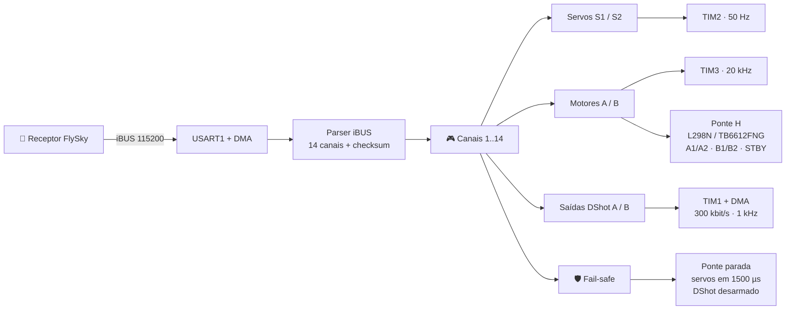

<div align="center">

# ⚡ ESC_Brushed

### Firmware de ESC escovado dual para STM32F103C8T6

**iBUS · FlySky · PWM · Ponte H (L298N / TB6612FNG) · Servo · DMA · STM32 HAL**


> **EN:** A compact, DMA-driven brushed ESC firmware for the STM32F103C8T6 (Blue Pill):
> FlySky iBUS input, dual H-bridge motor control, two servo outputs and a built-in
> fail-safe — all in bare-metal C with STM32 HAL.

**Construído sobre a biblioteca [J3 iBus FlySky](https://github.com/NelsonLima07/iBus_FlySky).**

</div>

<p align="center">
  
</p>

---

## 🚀 O que é este projeto?

Um firmware enxuto e direto ao ponto que transforma um **STM32F103C8T6 (Blue Pill)** em um
**controlador de ESC escovado duplo**. O receptor FlySky fala **iBUS** pela UART, o STM32
interpreta até **14 canais com checksum**, gera **dois PWM de servo** e comanda **duas pontes H**
para os motores — com **DMA**, **HAL** e **fail-safe** de série.

Sem bibliotecas pesadas, sem RTOS, sem bit-banging: só o essencial, em C, rodando a **72 MHz**.

---

## ✨ Destaques

- ⚡ **Recepção 100% por DMA** — a CPU não fica presa esperando bytes da UART.
- 🧠 **Biblioteca iBUS dedicada** — 14 canais, little-endian, com validação de checksum.
- 🎛️ **PWM em hardware** — TIM2 (servos, 50 Hz) e TIM3 (motores, **20 kHz na TB6612FNG** / 1 kHz no L298N) sem software timing.
- 🛰️ **Duas saídas DShot300** — TIM1 + DMA em PA8/PA9, 300 kbit/s a 1 kHz, coexistindo com as pontes H.
- 🚗 **Duas pontes H** — controle de sentido e velocidade para motores A e B.
- 🔌 **Duas opções de ponte** — L298N ou TB6612FNG, selecionável por macro em `main.h`.
- 🛡️ **Fail-safe inteligente** — sem sinal por 5 s, pontes param e servos centralizam.
- 🧩 **Estrutura modular** — aplicação isolada em `firmware/Core/Src/usr`, pronta para o CubeMX.
- 🛠️ **Build moderno** — CMake + Ninja com presets `debug`/`release`, toolchain ARM GNU e VS Code.
- 📦 **Biblioteca via submódulo** — versão reproduzível de [J3 iBus FlySky](https://github.com/NelsonLima07/iBus_FlySky).
- 🪶 **Leve** — ~11 KB de flash e ~1,9 KB de RAM no build Debug.
- 🔌 **Pronto para o Blue Pill** — pinagem documentada e configuração `.ioc` incluída.

---

## 🧠 Arquitetura



O fluxo é simples de propósito: **recebe → valida → mapeia → atua**. Cada quadro iBUS válido
atualiza os canais; o loop principal só aplica os valores nos periféricos.

---

## 🔌 Hardware e pinagem

| Função | Pino | Periférico / Configuração |
|---|---|---|
| iBUS RX | **PB7** | `USART1_RX` remapeado · 115200 8N1 |
| iBUS TX | **PB6** | `USART1_TX` remapeado (não utilizado) |
| Servo S1 | **PA2** | `TIM2_CH3` · 50 Hz · 1000–2000 µs |
| Servo S2 | **PA3** | `TIM2_CH4` · 50 Hz · 1000–2000 µs |
| Motor A (PWM) | **PA6** | `TIM3_CH1` · 20 kHz (TB6612) / 1 kHz (L298N) |
| Motor B (PWM) | **PA7** | `TIM3_CH2` · 20 kHz (TB6612) / 1 kHz (L298N) |
| Ponte A (sentido) | **PC14 / PC15** | `A1 / A2` (`AIN1/AIN2`) · GPIO push-pull |
| Ponte B (sentido) | **PA4 / PA5** | `B1 / B2` (`BIN1/BIN2`) · GPIO push-pull |
| Ponte STBY | **PB0** | `STBY` da TB6612FNG · `HIGH` habilita (não usado no L298N) |
| DShot A | **PA8** | `TIM1_CH1` · DMA1_Channel2 · 300 kbit/s · 1 kHz |
| DShot B | **PA9** | `TIM1_CH2` · DMA1_Channel3 · 300 kbit/s · 1 kHz |
| LED de status | **PC13** | GPIO · pisca a cada 1 s |
| Debug | **PA13 / PA14** | SWD |

> 📍 **Mapa completo de pinos:** [`Docs/Mapa_Pinos.md`](Docs/Mapa_Pinos.md) — inclui a vista dos
> conectores do Blue Pill, tabela de DMA, timers, pinos reservados e pinos livres.
>
> Consulte também `Docs/stm32f103c8t6_pinout_voltage01.png`, `Docs/Ponte_H_L298_HW95.jpg` e a seção
> [Pontes H suportadas](#-pontes-h-suportadas-l298n--tb6612fng) para a ligação de cada módulo.

---

## 🔌 Pontes H suportadas (L298N / TB6612FNG)

O firmware suporta as duas pontes pela macro `PONTE_H_TB6612`, em `firmware/Core/Inc/main.h`:

| `PONTE_H_TB6612` | Ponte | STBY | PWM dos motores |
|---|---|---|---|
| `1` (padrão) | **TB6612FNG** | **PB0** (obrigatório) | **20 kHz** |
| `0` | **L298N** | não existe | **1 kHz** |

A interface lógica é a mesma nos dois módulos — 2 pinos de sentido + 1 PWM por canal — então
apenas o STBY e a frequência mudam:

| Sinal | L298N | TB6612FNG | STM32 |
|---|---|---|---|
| Sentido A | `IN1` / `IN2` | `AIN1` / `AIN2` | PC14 / PC15 |
| PWM A | `ENA` | `PWMA` | PA6 (`TIM3_CH1`) |
| Sentido B | `IN3` / `IN4` | `BIN1` / `BIN2` | PA4 / PA5 |
| PWM B | `ENB` | `PWMB` | PA7 (`TIM3_CH2`) |
| Standby | — | `STBY` | PB0 (`HIGH` habilita) |
| Lógica (VCC) | 5 V | **3,3 V** | — |
| Saídas | `OUT1/OUT2`, `OUT3/OUT4` | `AO1/AO2`, `BO1/BO2` | — |

Para trocar de ponte, basta editar `main.h` e recompilar:

```c
/* firmware/Core/Inc/main.h */
#define PONTE_H_TB6612   1   /* 1 = TB6612FNG | 0 = L298N */
```

A frequência do PWM acompanha a ponte:

```c
#if PONTE_H_TB6612
  #define MOTOR_PWM_PSC   0u      /* 72 MHz  */
  #define MOTOR_PWM_ARR   3599u   /* 20 kHz · 3600 passos */
#else
  #define MOTOR_PWM_PSC   71u     /* 1 MHz   */
  #define MOTOR_PWM_ARR   999u    /* 1 kHz · 1000 passos */
#endif
```

### ⚠️ Diferenças elétricas que importam

| | L298N | TB6612FNG |
|---|---|---|
| Tensão do motor (VM) | 5–46 V | **2,5–13,5 V** (não use 4S) |
| Corrente contínua | ~2 A/canal | **1,2 A/canal** (3,2 A pico) |
| Queda de tensão | ~1,8–3 V | ~0,3 V |
| Regulador 5 V onboard | Sim | **Não** |
| Dissipação | Alta (dissipador) | Baixa |

- **STBY não pode flutuar**: a maioria dos módulos TB6612 tem pull-down; sem o PB0 em `HIGH` os motores não giram.
- **GND comum** entre bateria, ponte e STM32 é obrigatório.
- **Alimente o Blue Pill separadamente** ao usar TB6612 — o módulo não fornece 5 V.
- A queda de tensão menor da TB6612 faz o motor girar mais rápido no mesmo duty; recalibre os endpoints se necessário.
- No fail-safe o padrão é **freio** (STBY em `HIGH` + sentidos em nível baixo). Para **coast**, chame `J3_PonteH_Habilita(false)`.

---

## 🛰️ DShot300

Duas saídas **DShot300 unidirecionais** que **coexistem com as pontes H**: os motores escovados
continuam nos canais 3 e 4, e os ESCs DShot usam os canais **5 e 6**.

| Sinal | Pino | Timer | DMA | Nível |
|---|---|---|---|---|
| DShot A | **PA8** | `TIM1_CH1` | DMA1_Channel2 | 3,3 V |
| DShot B | **PA9** | `TIM1_CH2` | DMA1_Channel3 | 3,3 V |

| Parâmetro | Valor |
|---|---|
| Bit rate | **300 kbit/s** · `PSC = 0`, `ARR = 239` |
| Bit 0 / Bit 1 | `CCR = 90` (1,25 µs) / `CCR = 180` (2,5 µs) |
| Frame | 16 bits ≈ 53,3 µs · 11 throttle + 1 telemetria + 4 CRC |
| Repetição | **1 kHz** · idle em nível baixo |
| Telemetria | Unidirecional (bit sempre `0`) |

O throttle vai de `48` a `2047`; valores abaixo de `DSHOT_ARM_MAX` (1050 µs) resultam em **0
(desarmado)** e `1..47` são reservados para comandos DShot. O CRC é calculado sobre
`throttle << 1`:

```c
v     = throttle << 1;
crc   = (v ^ (v >> 4) ^ (v >> 8)) & 0x0F;
frame = (v << 4) | crc;
```

- O TIM1 é inicializado **manualmente em `dshot.c`**, fora do `.ioc`, para sobreviver à
  regeneração do CubeMX.
- `CH_DSHOT_A` / `CH_DSHOT_B` (5 e 6) ficam em `main_ESC_Brushed.c` e podem ser trocados.
- No fail-safe e no boot as saídas enviam **throttle 0**, mantendo os ESCs desarmados.
- O `CCR` usa **preload**: o DMA escreve o próximo bit no evento de comparação e o valor só
  entra em vigor no início do bit seguinte — sem glitch no pulso atual.
- Detalhes de pinos, DMA e temporização: [`Docs/Mapa_Pinos.md`](Docs/Mapa_Pinos.md#4-dshot300).

**API** (`firmware/Core/Inc/usr/dshot.h`):

| Função | O que faz |
|---|---|
| `J3_DShot_Init()` | Configura PA8/PA9, TIM1 e os dois canais de DMA |
| `J3_DShot_Set(a, b)` | Atualiza os alvos de throttle (0–2047) |
| `J3_DShot_Tarefa()` | Envia um frame a cada 1 ms, se o DMA estiver livre |
| `J3_DShot_Parar()` | Zera os alvos (desarmado) — boot e fail-safe |

---

## ⏱️ Temporização

| Periférico | Clock | Prescaler | Período | Resultado |
|---|---|---|---|---|
| SYSCLK | 8 MHz × 9 | — | — | **72 MHz** |
| TIM2 (servos) | 72 MHz | 71 | 19999 | **50 Hz** · pulso 1–2 ms |
| TIM3 (motores) | 72 MHz | 0 (TB6612) / 71 (L298N) | 3599 (TB6612) / 999 (L298N) | **20 kHz / 1 kHz** · duty 0–100% |
| TIM1 (DShot) | 72 MHz | 0 | 239 | **300 kbit/s** · frame 16 bits · 1 kHz |

---

## 📡 Protocolo iBUS (FlySky)

Cada quadro tem **32 bytes**:

```text
┌──────┬──────┬─────────────────────────────┬──────────────┐
│ 0x20 │ 0x40 │  CH1..CH14  (28 bytes, LE)  │  Checksum    │
└──────┴──────┴─────────────────────────────┴──────────────┘
   len    cmd          1000..2000 µs           0xFFFF - soma
```

O checksum é calculado como `0xFFFF - soma(todos os bytes do pacote)`. Se não bater, o quadro
é descartado e os canais anteriores são preservados — nada de valores corrompidos indo para os
motores.

---

## 🔗 Projetos relacionados

### 📡 J3 iBus FlySky — a biblioteca por trás do receptor

Este firmware nasceu junto com a biblioteca **[J3 iBus FlySky](https://github.com/NelsonLima07/iBus_FlySky)**,
uma implementação em C do protocolo iBUS para STM32 com HAL, DMA e validação de checksum.

| | Este projeto | J3 iBus FlySky |
|---|---|---|
| **Foco** | Aplicação completa de ESC escovado | Biblioteca reutilizável de iBUS |
| **Conteúdo** | Servos, pontes H, fail-safe, LED | Parser, receptor, API e exemplo |
| **Build** | CMake + Ninja (+ `.ioc`) | CMake + Ninja (+ `.ioc`) |
| **Licença** | GPL-3.0 | GPL-3.0 |

> A biblioteca é consumida como **submódulo Git** em `libs_github/iBus_FlySky`, fixada em um
> commit conhecido. Isso mantém uma única fonte de verdade, garante builds reproduzíveis e evita
> duplicar código GPLv3. A aplicação usa a API pública `J3_IBus_*` (inicialização, tarefa,
> leitura de canais e tratamento de callbacks da UART).

<p align="left">
  <a href="https://github.com/NelsonLima07/iBus_FlySky">
    
  </a>
</p>

---

## 🧩 Estrutura do projeto

```text
ESC_Brushed/
├── CMakeLists.txt                # build do firmware (CMake + Ninja)
├── CMakePresets.json             # presets debug / release
├── build.bat                     # atalhos de build no Windows
├── .clangd                       # IntelliSense/clangd via compile_commands.json
├── cmake/
│   └── arm-none-eabi.cmake       # toolchain ARM GNU
├── firmware/                     # projeto STM32 (ex-CubeIDE/J3_ESC_Brushed)
│   ├── Core/
│   │   ├── Inc/usr/              # headers da aplicação
│   │   ├── Src/usr/              # main_ESC_Brushed.c · dshot.c
│   │   ├── Src/                  # main.c · tim.c · usart.c · dma.c · gpio.c ...
│   │   └── Startup/startup_stm32f103c8tx.s
│   ├── Drivers/                  # STM32F1 HAL + CMSIS
│   ├── J3_ESC_Brushed.ioc        # configuração CubeMX
│   └── STM32F103C8TX_FLASH.ld    # linker script
├── libs_github/
│   └── iBus_FlySky/              # submódulo Git (biblioteca iBUS)
├── Docs/
│   ├── Descricao.txt
│   ├── Mapa_Pinos.md             # mapa completo de pinos (inclui DShot300)
│   ├── Esquema.png
│   ├── Ponte_H_L298_HW95.jpg
│   ├── stm32f103c8t6_pinout_voltage01.png
│   └── dm00042534-stm32-cross-series-timer-overview.pdf
├── .vscode/                      # settings, tasks, launch e extensões
├── LICENSE
└── README.md
```

---

## 🛠️ Como compilar

### Pré-requisitos

| Ferramenta | Versão sugerida | Instalação (Windows) |
|---|---|---|
| **CMake** | ≥ 3.25 | `winget install --id Kitware.CMake -e` |
| **Ninja** | ≥ 1.11 | `winget install --id Ninja-build.Ninja -e` |
| **ARM GNU Toolchain** | ≥ 12 | `winget install --id Arm.GnuArmEmbeddedToolchain -e` |
| **VS Code** | atual | [code.visualstudio.com](https://code.visualstudio.com/) |

Extensões recomendadas: **CMake Tools**, **C/C++** e **Cortex-Debug** (veja `.vscode/extensions.json`).

### Clone com submódulo

```bash
git clone --recursive https://github.com/NelsonLima07/ESC_Brushed.git
cd ESC_Brushed
```

Se o repositório já foi clonado sem `--recursive`:

```bash
git submodule update --init --recursive
```

### Linha de comando

```bash
cmake --preset debug          # configura
cmake --build --preset debug  # compila

# ou, no Windows:
build.bat                     # debug
build.bat release             # release (-Os)
build.bat all                 # debug + release
build.bat clean               # limpa build/ antes de compilar
```

Artefatos gerados em `build/debug/` e `build/release/`:

```text
J3_ESC_Brushed.elf   # executável com símbolos
J3_ESC_Brushed.hex   # para gravacao
J3_ESC_Brushed.bin   # imagem binaria
J3_ESC_Brushed.map   # mapa de memoria
```

### VS Code

1. Abra a pasta do repositório.
2. Aceite as extensões recomendadas.
3. O CMake Tools detecta os presets automaticamente (`debug`/`release`).
4. `Ctrl+Shift+B` compila o preset **debug**.
5. Para depurar, use a configuração **Debug (OpenOCD / ST-Link)** (requer OpenOCD e ST-Link).

> A gravação/depuração é opcional e depende de ferramentas externas. O build não precisa delas.
> O target `flash` usa `STM32_Programmer_CLI` ou `OpenOCD` quando disponíveis.

### Regeneração pelo CubeMX

O arquivo `firmware/J3_ESC_Brushed.ioc` continua versionado e já vem configurado para
**20 kHz** no TIM3 (padrão TB6612FNG). Ao regenerar o código, mantenha os blocos `USER CODE`,
confira o clock em **72 MHz** e reaplique no TIM3 os valores de `MOTOR_PWM_PSC` / `MOTOR_PWM_ARR`.
Para usar L298N, ajuste o TIM3 no CubeMX para prescaler `71` e período `999` (1 kHz).

O **TIM1 do DShot** e os **DMA1_Channel2/3** não estão no `.ioc`: são inicializados em
`firmware/Core/Src/usr/dshot.c` justamente para sobreviver à regeneração.

---

## ⚙️ Configuração rápida

| Macro | Padrão | O que faz |
|---|---|---|
| `CH_SERVO_A` | `1` | Canal do rádio para o servo S1 |
| `CH_SERVO_B` | `2` | Canal do rádio para o servo S2 |
| `CH_MOTOR_A` | `3` | Canal do rádio para o motor A |
| `CH_MOTOR_B` | `4` | Canal do rádio para o motor B |
| `RX_VAL_MIN` | `1000` | Pulso mínimo aceito (µs) |
| `RX_VAL_MAX` | `2000` | Pulso máximo aceito (µs) |
| `RX_REVERSE` | `true` | Habilita ré nos motores |
| `REVERSE_OFFSET` | `50` | Zona morta ao redor de 1500 µs |
| `FAIL_OVER_ATIVO` | `true` | Liga o fail-safe |
| `FAIL_OVER_TEMPO` | `5` | Tempo sem sinal até parar (s) |
| `PONTE_H_TB6612` | `1` | `1` = TB6612FNG · `0` = L298N |
| `MOTOR_PWM_PSC` / `MOTOR_PWM_ARR` | `0` / `3599` | PWM do TIM3 (20 kHz na TB6612) |
| `CH_DSHOT_A` / `CH_DSHOT_B` | `5` / `6` | Canais do rádio para as saídas DShot |
| `DSHOT_ARM_MAX` | `1050` | Abaixo disso (µs) a saída DShot vai para 0 (desarmado) |
| `DSHOT_THR_MIN` / `DSHOT_THR_MAX` | `48` / `2047` | Faixa de throttle DShot |
| `DSHOT_RATE_HZ` | `1000` | Repetição dos frames DShot |

Ajuste os canais conforme o seu rádio em `firmware/Core/Src/usr/main_ESC_Brushed.c`.

---

## 🛡️ Fail-safe

Se nenhum quadro válido chegar dentro de `FAIL_OVER_TEMPO` segundos:

- as duas pontes H vão para **parado** (PWM zerado antes de soltar a direção);
- na TB6612FNG o `STBY` permanece em `HIGH`, mantendo o **freio ativo** — para **coast**, chame
  `J3_PonteH_Habilita(false)` no fail-safe;
- os servos voltam ao **centro (1500 µs)**;
- o LED continua piscando como sinal de vida.

Quando o sinal volta, o controle é retomado automaticamente no próximo quadro válido.

---

## 🗺️ Roadmap

- [x] Recepção iBUS com DMA
- [x] Dois servos + duas pontes H
- [x] Suporte a L298N e TB6612FNG (seleção por macro)
- [x] Fail-safe por timeout
- [x] Saídas DShot300 (TIM1 + DMA) — especificadas em [`Docs/Mapa_Pinos.md`](Docs/Mapa_Pinos.md#4-dshot300)
- [x] Biblioteca iBUS via submódulo
- [x] Build CMake + Ninja + VS Code
- [ ] Modo de configuração (botão + EEPROM)
- [ ] Mixagem diferencial para tração
- [ ] DMA circular + interrupção de IDLE da UART
- [ ] Telemetria / debug por UART
- [ ] Ferramenta de calibração no PC
- [ ] Testes unitários do parser iBUS

---

## ⚠️ Notas de protótipo

- Este é um projeto em evolução — valide a pinagem e os limites de corrente antes de usar em
  cargas reais (TB6612FNG: **1,2 A contínuo/canal**, VM **≤ 13,5 V**).
- Ao regenerar o código pelo CubeMX, revise a configuração de clock e reaplique
  `MOTOR_PWM_PSC` / `MOTOR_PWM_ARR` no TIM3.

---

## 🤝 Contribuindo

Contribuições são bem-vindas! Abra uma **issue** com sua ideia ou envie um **pull request** com
melhorias de robustez, documentação ou novos recursos.

1. Faça um fork
2. Crie uma branch (`git checkout -b feature/minha-ideia`)
3. Commit (`git commit -m 'feat: minha ideia'`)
4. Push (`git push origin feature/minha-ideia`)
5. Abra o Pull Request

---

## 📄 Licença

Distribuído sob a **GPL-3.0**.

Este projeto utiliza a biblioteca
[J3 iBus FlySky](https://github.com/NelsonLima07/iBus_FlySky), também licenciada sob GPL-3.0.
Veja o arquivo [`LICENSE`](LICENSE) para mais detalhes.

---

## 👤 Autor

**Nelson Lima** · [@NelsonLima07](https://github.com/NelsonLima07)

---

<div align="center">

**STM32** · **STM32F103C8T6** · **Blue Pill** · **ESC escovado** · **Brushed ESC** · **Ponte H** ·
**H-Bridge** · **L298N** · **TB6612FNG** · **HW95** · **iBUS** · **FlySky** · **J3 iBus FlySky** · **RC** ·
**Servo** · **PWM** · **DShot300** · **ESC** · **DMA** · **UART** · **STM32CubeMX** · **STM32 HAL** · **CMake** · **Ninja** ·
**VS Code** · **Firmware** · **C** · **GPLv3** · **Robótica** · **DIY**

*Feito com ⚡ e alguns fios a mais.*

</div>
